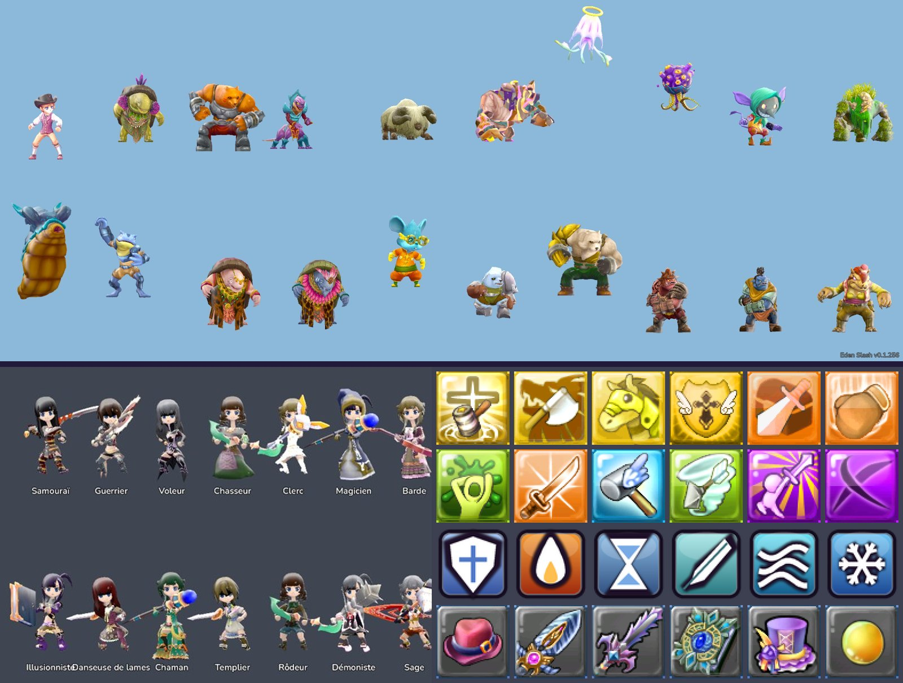
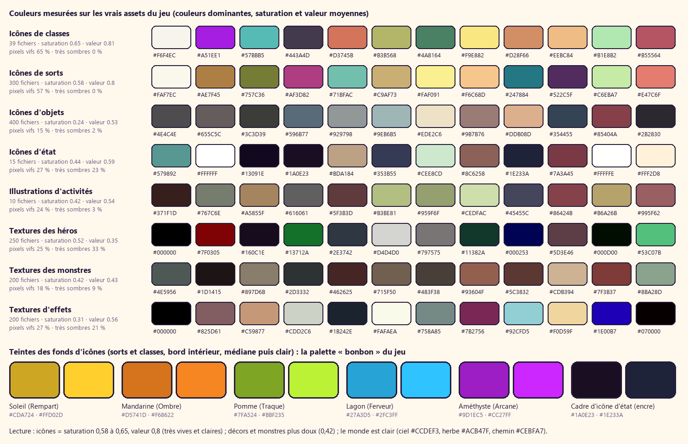
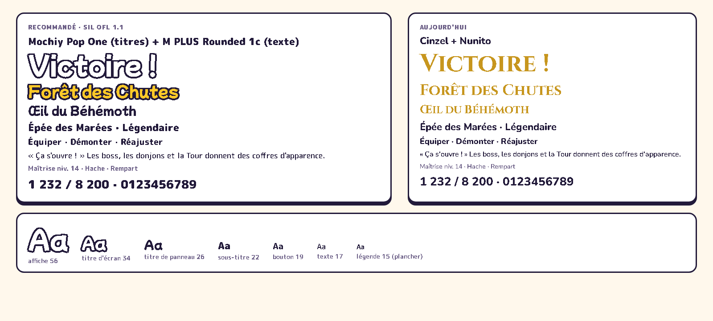

# Bible de style d'Eden Slash, v2 : la DA du jeu appliquée à l'interface (17/10/2026)

Fait foi pour tous les départements (`ORGANISATION.md`, règle 1). La v1 (« bronze et émail », un thème inventé) est
abandonnée et archivée dans `archive_v1/`. **On n'invente pas de thème : on applique partout la DA qui existe déjà dans les
classes, les monstres, les icônes et les effets du jeu.** Les icônes et assets du jeu de base (sorts, objets, classes, statuts,
illustrations) sont **gardés** ; le travail porte sur ce que nous n'avons pas : boutons, menus, sous-menus, cadres, jauges, onglets,
fenêtres, et le **ressenti du clic**.

Valeurs exactes : `tokens.json` (v2). Images : `bible/da_reelle.jpg` (la DA mesurée), `bible/palette_reelle.png`, `bible/typo.png`,
`pistes/b_*.jpg` (piste retenue sur écrans réels), `pistes/comparaison.html`. Tailles en px à 1600×900 (× 0,8 à 1280×720).

---

## 1. La DA qui existe déjà (mesurée sur les assets)

| Source | Ce qu'on mesure | Ce qu'on en retient pour l'interface |
|---|---|---|
| Icônes de sorts et de classes (339 fichiers) | saturation moyenne 0,58 à 0,65, valeur 0,8 ; 57 à 65 % de pixels vifs ; **5 teintes de fond** : soleil `#FFD02D`, mandarine `#F68622`, pomme `#BBF235`, lagon `#2FC3FF`, améthyste `#CC27FF` (saturation 0,8) | les 5 « bonbons » sont la palette d'accent de l'interface, et les couleurs des 5 familles |
| Forme des icônes | carré à coins **très arrondis** (≈ 20 % du côté), dégradé clair en haut à gauche → saturé en bas à droite, **reflet blanc** sur l'arête haute, **rayons de soleil** derrière le sujet, étincelles en étoile à 4 branches, sujet **contouré** brun-encre, ombré en 2 ou 3 tons nets | coins ronds, reflet blanc, rayons, étoiles, contour, aplats cel |
| Icônes d'état | cadre épais **bleu-nuit encre** (`#1A0E23`, `#1E233A`), tuile saturée, symbole blanc contouré | l'**encre** `#221A3A` est la couleur de contour de toute l'interface |
| Héros (60 classes) | chibi, grosses têtes, yeux d'anime, tenues sombres (noir, bordeaux, blanc, or) et **armes pastel lumineuses** (menthe, rose, bleu) | l'interface reste claire et colorée autour de héros plutôt sombres : elle ne doit pas les noyer |
| Monstres | ronds, trapus, très colorés (ours orange, gobelin sarcelle, méduse lilas), toon doux | rondeur, gaieté, jamais d'angle agressif |
| Scènes | monde **clair** : ciel `#CCDEF3`, herbe `#ACB47F`, chemin `#CEBFA7` ; les décors et textures sont plus doux (saturation 0,42) que les icônes | le contour d'encre sépare l'interface d'un fond clair ; pas d'interface sombre plaquée sur un monde ensoleillé |
| Effets | textures douces, halos blancs, couleurs pastel | lueurs blanches et pastel, pas de néon |

## 2. Principes
1. **Autocollant d'encre et de bonbon.** Tout élément d'interface est une pièce découpée : contour d'encre de 3 px, aplat de couleur
   en deux tons nets (cel), reflet blanc, ombre dure décalée. Comme les icônes et les personnages du jeu.
2. **Clair dehors, encre dedans.** Les panneaux sont du papier crème ; les zones denses (listes, grilles, tuiles de bilan, HUD) sont
   des puits d'encre. Deux surfaces seulement.
3. **Les 5 bonbons ont un sens.** Soleil = action principale et récompense ; lagon = focus et sélection ; pomme = gain, validation ;
   fraise = vie, danger, compteur ; mandarine = onglet actif, nouveauté ; améthyste = épique, magie. Rareté = code des icônes du jeu.
4. **Chaque clic se sent.** Survol, appui, relâchement, son, vibration : l'élément s'écrase sur son ombre et rebondit (§ 7).
5. **Le manga pour les moments, le calme pour le reste.** Traits de vitesse, éclats, étoiles et onomatopées seulement sur un
   événement (victoire, récompense, montée de niveau, critique) ; au repos, l'écran est calme et lisible.

## 3. Couleurs
| Famille | Jetons (`couleur.*`) | Usage |
|---|---|---|
| Encre | 900, **700** `#221A3A`, 500 `#2E2450`, 300, 100 | contours, texte sur papier, ombres dures ; 500 = puits sombres |
| Papier | blanc, **100** `#FFF8EC`, 200, 300 | fonds des panneaux, onglets inactifs, bande d'ombre des boutons clairs |
| Bonbons | soleil, mandarine, pomme, lagon, améthyste, fraise × clair / base / foncé | actions, états, familles, raretés |
| Texte | sur papier, sur encre, sur bonbon (blanc **toujours contouré d'encre**), gain, perte, désactivé | — |

Contrastes mesurés : encre sur papier 15,6:1 ; encre-300 sur papier 5,6:1 ; papier sur encre-500 13,4:1 ; gain `#3E7F0A` sur papier
4,7:1 ; désactivé `#6F6787` sur gris 4,1:1. **Le blanc sur un bonbon ne fait que 1,5:1** : le texte blanc sur couleur n'est lisible
que grâce à son contour d'encre (7 à 10:1 entre encre et bonbon) ; jamais de texte blanc sans contour. Le focus manette utilise le
lagon **foncé** `#0B7DB5` (4,3:1 sur papier) doublé d'un liseré blanc.
**Raretés** : Commun lilas-gris, Spécial pomme, Rare lagon, Épique améthyste, Mythique mandarine, Légendaire soleil (+ rayons
tournants et étoile). **Familles** : Rempart soleil, Ombre mandarine, Traque pomme, Ferveur lagon, Arcane améthyste (les couleurs
des icônes de classes). **Équipes** (modes d'équipes, lot MODE-0, jetons `couleur.equipe`, ordre fixe) : Azur (rond), Braise
(carré), Citron (triangle), Améthyste (losange), Menthe (étoile), Griotte (croix), Marine (hexagone), Perle (anneau) ; 2 équipes =
azur / braise. Une couleur d'équipe ne va **jamais sans son motif** (blason `TeamSigil`) : les 8 restent distinctes pour les trois
daltonismes (écart ≥ 11, `tools/team_palette_check.py`). Elle sert au blason, au classement, au contour et au sol, **jamais** aux
barres de vie (pomme = mon équipe, fraise = adversaires). **Interdits** : noir pur, gris neutres froids, dégradés multicolores, néon, verre dépoli, fonds sombres pleins
derrière un écran de menu.

## 4. Typographie

| Rôle | Police | Licence (vérifiée dans `google/fonts`) |
|---|---|---|
| Titres, logo, boutons primaires, grands chiffres | **Mochiy Pop One** : pop japonaise ronde et épaisse, l'allure des titres de jeux d'animation | SIL OFL 1.1, « Mochiypop Project Authors », aucun nom réservé |
| Texte, boutons, listes, chiffres | **M PLUS Rounded 1c** : gothique arrondie japonaise, ouverte, 7 graisses | SIL OFL 1.1 (M+ Fonts Project), sous-ensembles latin et latin-ext |

Les deux ont tous les accents du français, `Œ œ Ç « »` (vérifié au rendu). Cinzel (serif romaine) est hors DA ; Nunito est ronde mais
générique : M PLUS Rounded 1c garde la rondeur avec une allure de jeu japonais. **Sous-ensembler** M PLUS Rounded (latin + latin-ext +
ponctuation, `pyftsubset`) : le fichier complet porte les glyphes japonais (plusieurs Mo par graisse).
**Échelle** : affiche 56 · titre d'écran 34 · titre de panneau 26 · sous-titre 22 · bouton 19 · texte 17 · légende 15 (plancher).
Logo 74, chiffre héros 44, chiffres du HUD 26.
**Contour d'encre** (`Label.outline_size`, vrai contour, pas une ombre) : 3 px jusqu'à 19 px, 5 px à 22-26, 7 px à 34, 9 px à 44-56,
12 px au logo ; approche +0,03 em quand le texte est contouré (sinon les lettres se collent). Titres d'écran et logo inclinés de −3°.
Chiffres : tabulaires (`tnum`) partout où ils changent. Français : espace fine insécable avant `; : ! ?`, espace insécable des milliers.

## 5. Formes (piste « autocollant manga », `forme.*`)
| Élément | Rayon | Contour | Remplissage | Ombre | Détails |
|---|---|---|---|---|---|
| Panneau | 18 | 3 px encre | papier-100 ; trame manga dans le bas (22 %) | dure 7 px encre + douce 14/24 px à 25 % si posé sur la scène | titre en Mochiy contouré, incliné −3°, posé à cheval sur le bord |
| Puits | 14 | 3 px encre | encre-500 | aucune | texte papier ; listes, grilles, tuiles |
| Bouton | 14 | 3 px encre | 2 tons cel : 12 % reflet clair, 50 % base, 38 % foncé, bords nets | dure 5 px | trait de reflet blanc 16×6 incliné −12° en haut à gauche |
| Case d'objet | 14 | 3 px encre | 2 tons de la rareté | dure 4 px | niveau dans une pastille d'encre ; légendaire : rayons tournants + étoile |
| Onglet | 12 en haut | 3 px encre, sans bas | inactif papier-200 (40 px) ; actif mandarine (48 px, dépasse) | — | l'onglet actif « sort » du panneau |
| Jauge | 12 | 3 px encre | creux encre-500 ; remplissage 2 tons + bord droit d'encre ; trace claire des dégâts | dure 3 px | graduations d'encre pour les boss |
| Pastille | 10 | 3 px encre | fraise (compteur), mandarine (nouveau) | dure 3 px | inclinée 8° |
| Carte d'activité | 16 | 3 px encre | **vraie image du jeu** + voile bas encre 0 → 85 % | dure 6 px | étiquette de rôle autocollante inclinée −4°, 2 icônes du jeu au plus |
| Infobulle | 14 | 3 px encre | papier | dure 4 px | nom en couleur de rareté (foncé), queue de bulle vers l'élément |

**Godot** : un shader commun `ui_sticker.gdshader` (rectangle arrondi par SDF : contour, deux tons à bord net, reflet, trame, ombre
dure) posé sur un `Panel` / `StyleBoxTexture` ; à défaut, `StyleBoxFlat` (fond, `border_width` 3 encre, `corner_radius` 14,
`anti_aliasing`) + une seconde boîte d'encre décalée de 5 px pour l'ombre dure, et une texture `GradientTexture2D` à interpolation
constante pour les deux tons. Le contour d'encre ne descend jamais sous 2 px à 1280×720.

## 6. Composants et états (`pistes/b_kit.jpg`)
| Composant | Repos | Survol | Appui | Désactivé | Focus manette | Sélectionné |
|---|---|---|---|---|---|---|
| Bouton (52 px) | papier, texte encre 19 | monte de 3 px, ombre 8 px, −1° | descend de 5 px sur son ombre (ombre 0) | gris lilas tramé, contour encre-300, texte désactivé **+ cadenas et condition** | liseré blanc 6 px + anneau lagon foncé 3 px + monte de 3 px ; respire (§ 8) | fond lagon, texte blanc contouré |
| Bouton primaire (64 px, un par écran) | soleil, Mochiy 26 blanc contouré | idem + rayons de soleil derrière (15 % d'opacité) | idem | tramé | idem | — |
| Action douce | lagon | idem | idem | idem | idem | — |
| Destructif | fraise, et demande une confirmation `InfoCard.ask` | idem | maintien 0,6 s (anneau qui se remplit) | idem | idem | — |
| Onglet | papier-200 | texte foncé, monte de 2 px | s'écrase | tramé + cadenas | anneau lagon | mandarine, plus haut, dépasse du panneau ; LB / RB dessinés à côté |
| Case d'objet | 2 tons de rareté | monte de 3 px + infobulle après 300 ms | s'écrase | icône à 40 % + cadenas | anneau | coche pomme autocollante dans le coin |
| Case vide | papier tramé, silhouette de l'emplacement à 30 % | contour lagon | — | — | anneau | — |
| Carte d'activité | image + voile | monte de 4 px, −1°, ombre 10 px, image +6 % de clarté | s'écrase | image en gris 85 %, cadenas + **condition écrite** | anneau | — |
| Interrupteur | piste encre contourée, bouton blanc | — | le bouton s'aplatit | tramé | anneau | piste pomme |
| Jauge | — | — | — | — | — | se remplit par à-coups (§ 7) |

**États vides** : une illustration ou une icône du jeu en grand, une phrase, une action (« Les boss en donnent : lancer une Survie »).
Les grilles grandissent avec le contenu. **Touches** : pastilles rondes de couleur (A pomme, B fraise, X lagon, Y soleil), lettre blanche contourée.

## 7. Ressenti du clic (spécification)
Implémentation : un autoload `UiFeel` branché sur tous les `BaseButton` (comme `UiNav`) : `mouse_entered`, `mouse_exited`,
`focus_entered`, `button_down`, `button_up`, `pressed`, et un appui sur un bouton désactivé (`gui_input`). `pivot_offset = size / 2`
(bas-centre pour les cartes), un seul `Tween` par contrôle (le précédent est tué), jamais d'animation de `size` (seulement `scale`,
`position` d'un enfant visuel, `modulate`) pour ne pas déplacer la mise en page. Réglage « Réduire les animations » : échelle et
particules coupées, il reste couleur, son et vibration.

| Élément | Survol / focus (entrée) | Appui (`button_down`) | Relâchement (`pressed`) | Son | Vibration (faible, fort, s) | Particules |
|---|---|---|---|---|---|---|
| Bouton | 90 ms ressort : échelle 1,04, visuel −3 px, ombre 8 px ; sortie 140 ms | 60 ms quad-in : échelle (1,06 ; 0,90), visuel +5 px, ombre 0 | 220 ms ressort : (0,97 ; 1,05) → 1,0 | survol −26 dB « tic » de bois ; appui −14 dB « pop » mat ; relâchement −12 dB « clic » clair ; hauteur ±3 % | focus (0,06 ; 0 ; 0,025) ; appui (0,18 ; 0 ; 0,04) | aucune |
| Bouton primaire | idem + rayons derrière, 0 → 15 % en 120 ms | idem | idem + **anneau** blanc qui s'élargit (rayon +24 px, 260 ms, 80 % → 0) + **4 étincelles** en étoile (soleil, blanc, lagon, fraise), 300 ms, vers l'extérieur | « pop » −9 dB + petit carillon montant | (0,25 ; 0,12 ; 0,07) | 4 étoiles + anneau |
| Bouton refusé (désactivé) | — | — | **secousse** horizontale ±4 px, 3 allers-retours en 240 ms ; cadenas qui saute de 2 px ; la condition s'affiche en infobulle | « bonk » sourd −14 dB | (0 ; 0,35 ; 0,09) | aucune |
| Onglet | 90 ms : monte de 2 px | 60 ms : s'écrase | le nouvel onglet monte à 48 px en ressort 200 ms ; le contenu glisse de 24 px vers le sens du changement (260 ms) en fondu | « flip » de page −16 dB | (0,1 ; 0 ; 0,03) | aucune |
| Case d'objet | 90 ms : 1,06 + monte de 3 px ; infobulle après 300 ms (apparition 160 ms en ressort depuis 0,9) | 60 ms : 0,92 | équiper : la pièce « saute » vers son emplacement (arc de 280 ms) puis l'emplacement fait 1,15 → 1,0 | « clac » d'équipement −12 dB, selon la matière (métal, tissu, bijou) | (0,15 ; 0 ; 0,04) | légendaire : 6 étincelles soleil |
| Carte d'activité | 120 ms : monte de 4 px, −1°, image +6 % | 60 ms : 0,97 | 220 ms ressort, puis la page s'ouvre | « swoosh » −14 dB | (0,15 ; 0 ; 0,04) | aucune |
| Interrupteur | — | le bouton s'aplatit (1,2 ; 0,8) 60 ms | glisse 160 ms ressort ; la piste change de couleur en 120 ms | « clic-clac » −16 dB, plus aigu à l'allumage | (0,1 ; 0 ; 0,03) | allumage : 2 petites étoiles pomme |
| Choix de carte (`CardPicker`) | la carte monte de 8 px, 1,03, −1,5° | 0,96 | la carte choisie fait 1,12 en 180 ms puis file vers le HUD (350 ms) ; les autres tombent et s'effacent (220 ms) | « shing » −10 dB | (0,25 ; 0,1 ; 0,06) | traits de vitesse derrière la carte choisie |
| Récompense (coffre, bilan) | — | — | ouverture en 520 ms élastique ; rayons de soleil tournants (1 tour / 12 s) ; nombres qui défilent en 800 ms ; chaque gain apparaît avec 70 ms de décalage | signature par rareté (6 notes qui montent) −6 dB | (0,3 ; 0,45 ; 0,18) | confettis des 5 bonbons, 24 au plus, 1,2 s |
| Navigation manette | le cadre de focus **glisse** d'un contrôle à l'autre en 120 ms (sortie cubique) au lieu de sauter | A = appui puis relâchement réels | — | tic de focus −22 dB (rien si le focus ne bouge pas) | focus (0,06 ; 0 ; 0,025) | aucune |

Règles : jamais deux sons d'interface à moins de 40 ms (le second est ignoré) ; jamais de vibration pendant un télégraphe de boss ;
pas de particules sur un écran déjà chargé (plus de 40 contrôles visibles) ; toute animation d'interface tourne aussi en pause (`PROCESS_MODE_ALWAYS`).

## 8. Vocabulaire manga (quand et où)
| Signe | Où | Quand |
|---|---|---|
| Traits de vitesse (rayons blancs fins depuis un centre) | derrière « Victoire ! », la carte choisie, le coffre qui s'ouvre | sur l'événement, 1 à 2 s, puis disparaît |
| Rayons de soleil (comme le fond des icônes) | derrière le bouton primaire survolé, la case légendaire, la récompense | en boucle lente (1 tour / 12 s) |
| Étincelles en étoile à 4 branches | logo, coins des récompenses, relâchement du primaire | 1 à 4 à la fois |
| Bulle de dialogue (queue vers la source) | avis du lobby, astuces, infobulles, PNJ | permanent, mais une seule bulle par écran |
| « ! » rond fraise | nouveauté, alerte | permanent tant que non vu |
| Onomatopées stylisées en Mochiy contouré : « Critique ! », « Parfait ! », « Esquive ! », « Niveau ! » | au-dessus du héros dans le HUD | 600 ms, une à la fois, empilées jamais superposées |
| Trame de points | ombre des panneaux, états désactivés | permanent |
| Confettis des 5 bonbons | bilans de victoire, récompenses rares | 1,2 s |
Interdits : gouttes de sueur et visages dessinés sur l'interface, textes en japonais, lignes de vitesse au repos.

## 9. Icônes et illustrations (on garde l'existant)
- **Toutes les icônes du jeu restent** (sorts, objets, classes, statuts, monnaies) : on les pose dans nos cases (rayon 14, contour
  d'encre, rareté), sans les repeindre.
- Pictogrammes **manquants** seulement (menus, actions sans icône) : dessinés dans le style des icônes d'état (symbole blanc
  contouré d'encre sur tuile bonbon arrondie, reflet en haut) ; ils remplacent les pictogrammes génériques blancs de `assets/ui/icons/`.
- Illustrations d'activités : les **vues du jeu** actuelles restent la base (cadrées en autocollant, voile bas) ; on les éclaircit
  plutôt que de les assombrir ; pas d'illustration peinte qui ne ressemble pas au jeu.

## 10. HUD et effets
- Même famille : jauges contourées d'encre, chiffres en M PLUS Rounded 900 contourés, emplacements de sorts = cases autocollantes
  (vides : trame + chiffre de la touche, jamais « — »).
- Télégraphes d'attaque ennemis : bord net clair 2 px + intérieur fraise/mandarine à 35 % au plus, qui monte pendant l'armement ;
  jamais modifiés par `Settings.fx_factor`.
- Textes flottants : empilés, Mochiy pour les critiques et onomatopées, M PLUS Rounded 900 pour les dégâts normaux, contour d'encre.

## 11. Mouvement et son (résumé)
Durées et courbes : `tokens.json` → `mouvement` (appui 60, relâchement 220 ressort, survol 90 / 140, focus 120, page 260, récompense
520 élastique, compteur 800). Ce qui bouge : ce qu'on touche, ce qui arrive, ce qu'on gagne. Ce qui reste calme : fonds, panneaux,
textes au repos. Sons : matière « jouet » (bois, plastique, carillon, papier) courts (< 150 ms), hauteur ±3 %, signatures de rareté ;
la musique baisse de 4 dB sur les bilans.

## 12. À faire / à ne pas faire (grille de la revue)
| À faire | À ne pas faire |
|---|---|
| Contour d'encre 3 px, deux tons cel, reflet, ombre dure | Rectangles plats à filet doré, dégradés lisses sans contour |
| Panneaux papier, puits d'encre | Grands fonds sombres pleins sur un monde clair |
| Texte blanc seulement contouré d'encre | Texte blanc ou pastel sur bonbon sans contour |
| Les icônes du jeu dans nos cases | Repeindre ou remplacer les icônes du jeu |
| Un clic = écrasement + rebond + son + vibration | Boutons qui changent seulement de couleur |
| Manga sur les événements | Effets manga permanents |
| Mots du jeu : partie, menu principal, panoplie, stratégie | run, lobby, set, RTS / MOBA, % dans le texte permanent |
