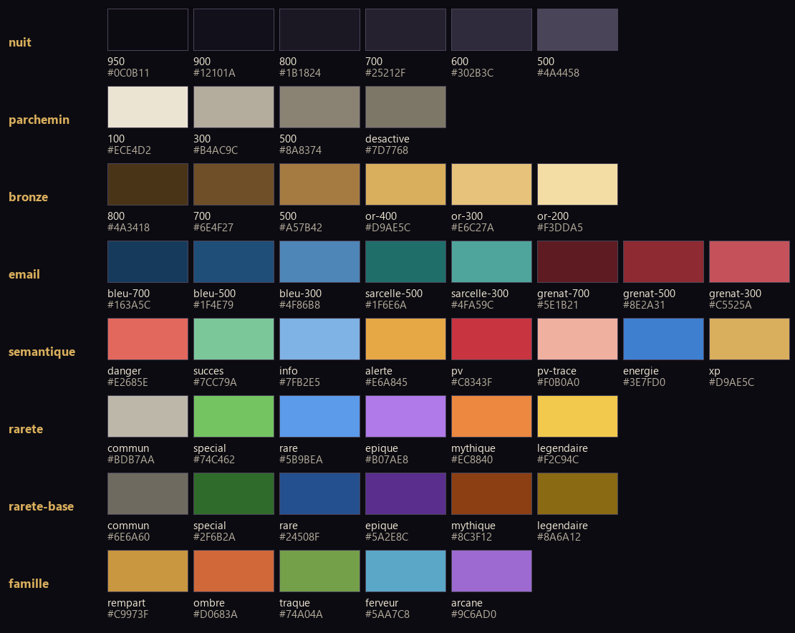

# Bible de style d'Eden Slash (v1, 17/10/2026)

Fait foi pour tous les départements (`ORGANISATION.md`, règle 1). Piste retenue par la DA : **bronze et émail**
(à confirmer par le joueur, `pistes/comparaison.html`). Valeurs exactes : `tokens.json`. Images de référence :
`bible/composants.png` (tous les composants, tous les états), `bible/maquette_lobby.png`, `bible/palette.png`, `bible/typo.png`.
Toutes les tailles sont données en px à 1600×900 ; à 1280×720 elles sont multipliées par 0,8, jamais sous le plancher du texte.

---

## 1. Principes
1. **Un objet d'orfèvre, pas une application.** Chaque surface a une matière : bronze (cadres, actions), émail (sélection,
   accents), nuit (fonds), parchemin (le texte, et les pages « papier »). Aucun rectangle arrondi uni.
2. **Trois profondeurs, jamais deux fois la même l'une dans l'autre.** Fenêtre (double filet, ombre large) > carte (filet
   simple, ombre courte) > ligne (aucun cadre, un séparateur). Un bouton n'est jamais dans une boîte qui ressemble à un bouton.
3. **Une idée et un bouton primaire par écran.** Le primaire est la seule plaque d'or poli de l'écran.
4. **La couleur dit l'état, la forme le confirme.** Toute information portée par une couleur l'est aussi par une forme, une
   position ou un mot (rareté = couleur + rivets ; verrou = gris + cadenas + condition ; gain = vert + ▲).
5. **Le monde d'abord.** La scène 3D reste visible, l'interface est calme ; ce qui bouge a une raison ; la lisibilité du combat
   passe avant l'éclat des effets.

## 2. Couleurs (palette fermée)

| Famille | Jetons | Usage | Part de l'écran |
|---|---|---|---|
| Nuit | 950, 900, 800, 700, 600, 500 | fonds (950 page plein écran, 900 page, 800 fenêtre, 700 carte / bouton, 600 survol), 500 filets décoratifs | ≈ 70 % |
| Parchemin | 100 (texte), 300 (secondaire), 500 (légende), désactivé | **tout le texte** ; jamais de blanc pur | ≈ 15 % |
| Bronze | 800, 700, 500, or-400, or-300, or-200 | bordures (500), titres et valeurs clés (or-400), reflets (or-300), focus et onglet actif (or-200) | ≈ 10 % |
| Émail | bleu 700 / 500 / 300, sarcelle 500 / 300, grenat 700 / 500 / 300 | bleu = **sélection** ; sarcelle = ornement rare ; grenat = action destructive | ≈ 4 % |
| Sémantique | danger, succès, info, alerte, pv, pv-trace, énergie, xp | texte de perte / gain, jauges | ≈ 1 % |

Contrastes mesurés sur nuit-800 : parchemin-100 13,8:1, -300 7,7:1, -500 4,6:1 (plancher AA), or-400 8,5:1, bordure bronze-500
4,6:1 (seuil des contours : 3:1). **Interdits** : blanc `#FFFFFF` et noir `#000000` purs, rouge et vert purs, couleur de rareté en
fond plein d'une carte, dégradés multicolores, néon.

**Raretés** (`couleur.rarete.*` : `base` pour le métal du cadre, `texte` pour le nom, `eclat` pour la lueur) : Commun gris chaud,
Spécial vert, Rare bleu, Épique violet, Mythique orange, Légendaire or. On garde les teintes que les joueurs connaissent, ternies
d'un cran pour s'accorder au bronze. La rareté se lit aussi sans couleur (§ 5, case d'objet).

**Familles de classes** (`couleur.famille.*`, données `family` 1 à 5) : Rempart ocre `#C9973F`, Ombre braise `#D0683A`, Traque
mousse `#74A04A`, Ferveur ciel `#5AA7C8`, Arcane améthyste `#9C6AD0`. Usage : losange d'emblème, liseré de portrait, trait de la
famille dans l'Échiquier ; **jamais** sur un cadre d'objet (réservé à la rareté).

## 3. Typographie

| Rôle | Police | Licence | Graisses |
|---|---|---|---|
| Titres (écran, fenêtre, bilan, bouton primaire, noms de zone) | **Alegreya SC** (Huerta Tipográfica) | SIL OFL 1.1, aucun nom réservé (vérifié dans `google/fonts`, `ofl/alegreyasc/OFL.txt`) | ExtraBold 800, Bold 700 |
| Texte, boutons, chiffres | **Alegreya Sans** (Huerta Tipográfica) | SIL OFL 1.1, aucun nom réservé (`ofl/alegreyasans/OFL.txt`) | Medium 500, Bold 700, ExtraBold 800 |
| Variante de titre, si le joueur la choisit | Grenze Gotisch (Omnibus-Type) | SIL OFL 1.1, aucun nom réservé (`ofl/grenzegotisch/OFL.txt`) | Bold 700, ≥ 36 px seulement |

Pourquoi : une famille calligraphique humaniste (plume, contrastes doux) qui a une vraie personnalité sans être un pastiche
médiéval ; petites capitales dessinées (pas des capitales réduites) ; tous les accents du français, `Œ`, `œ`, guillemets ;
chiffres alignés et tabulaires. Cinzel (« Trajan » de toutes les affiches de fantasy) et Nunito (police ronde d'application)
sont abandonnées. Les fichiers OFL accompagnent les polices dans `game/assets/fonts/`.

**Échelle (7 tailles, aucune autre)** : affiche 56 · titre d'écran 36 · titre de panneau 28 · sous-titre 22 · fort / bouton 19 ·
texte 17 · légende 15 (plancher ; Alegreya Sans a un œil plus petit que Nunito : 15 px Alegreya ≈ 14 px Nunito). HUD : chiffres 24.
Règles :
- Petites capitales (Alegreya SC) seulement pour les titres de 6 mots au plus ; jamais de capitales en Sans, sauf les badges (15 px,
  approche +6 %).
- Chiffres : `lnum` + `tnum` partout où un nombre change ou s'aligne (Godot : `FontVariation.opentype_features`).
- Interlignes : 1,15 titres, 1,4 texte, 1,5 paragraphes ; lignes de 45 à 75 signes.
- Français : espace fine insécable avant `; : ! ?` et dans les guillemets « », espace insécable dans les milliers (`1 232`).
- Texte posé sur la scène 3D : toujours sur une plaque `voile.hud-plaque` (65 %), sinon contour 2 px nuit-950 à 80 %.

## 4. Formes
**Coins coupés à 45°, jamais arrondis** (chanfrein, `forme.chanfrein` : fenêtre 10, carte 6, bouton 5, case 4, badge 3, infobulle 4).
Seuls arrondis permis : la piste de l'interrupteur, les pierres serties, l'intérieur d'une jauge (2 px).
- Godot : `StyleBoxFlat` avec `corner_radius_* = chanfrein` et **`corner_detail = 1`** donne exactement un coin coupé, bordure comprise.
  Les dégradés et l'usure passent par un shader commun `ui_plate.gdshader` (SDF du rectangle chanfreiné, filet, dégradé vertical,
  bruit) ou par des textures 9-slice fabriquées par script (`tools/art/`).

| Niveau | Bordure | Fond | Ombre | Ornement |
|---|---|---|---|---|
| Fenêtre | double filet : 2 px bronze dégradé (or-300 en haut → bronze-800 en bas), 3 px d'écart, 1 px bronze-700 | nuit-800, dégradé +4 % de clarté en haut, grain 3,5 % | 0 / 6 / 18 px, noir 55 % | deux incrustations d'émail sarcelle (28×4) en haut ; cartouche de titre |
| Carte | 1 px bronze-500 (ou rareté) | nuit-700 | 0 / 2 / 6 px, noir 40 % | aucun |
| Ligne | aucune | transparent, survol nuit-600 | aucune | séparateur 1 px nuit-500 fondu sur 24 px aux deux bouts |
| Bouton | 1 px bronze dégradé + biseau 1 px (haut or-300 35 %, bas bronze-800) | dégradé nuit-600 → nuit-700 | aucune | aucun |
| Case | 2 px couleur de rareté (`base`) | creux : dégradé radial `#2A2535` → `#15121C` + ombre intérieure | aucune | rivets selon la rareté |

**Matière** : métal = dégradé vertical clair en haut, sombre en bas, reflet de 1 px or-300 sur l'arête haute ; **usure** = bruit le long
du contour (amplitude 0,6 px, `forme.usure`), pour que deux coins ne soient jamais parfaitement identiques ; émail = aplat légèrement
dégradé avec un reflet clair de 30 % sur la moitié haute ; grain des fonds = bruit fractal tuilé 256 px à 3,5 %.
**Lueur** : une seule, réservée au focus manette (or-200, 6 px, respire entre 25 et 45 % en 1,6 s) et, plus lente, au légendaire.
**Ornements** permis : coins des fenêtres, cartouche de titre d'écran, séparateur orné (sous un titre d'écran ou de bilan seulement),
cadre des bilans de victoire. **Interdits** : losange posé au milieu d'un filet, volutes sur tous les bords, chaînes et cadenas en
clip-art, cadre dans un cadre, ombres colorées, verre dépoli, pilules (sauf l'interrupteur).

## 5. Composants (tous les états : `bible/composants.png`)
| Composant | Normal | Survol (120 ms) | Pressé (80 ms) | Désactivé | Focus manette | Sélectionné |
|---|---|---|---|---|---|---|
| Bouton secondaire (44 px) | plaque nuit, filet bronze-500, texte parchemin 19 Bold | filet or-300 → bronze-500, fond +1 cran, texte `#FFF7E6` | descend de 1 px, dégradé inversé, texte or-200 | fond nuit-800, filet nuit-500, texte désactivé **+ raison** (cadenas + condition en légende ou infobulle) | anneau or-200 2 px à 3 px du bord, lueur qui respire ; le bouton prend aussi l'état survol | fond émail bleu-700, barre d'émail 3 px à gauche, texte or-200 |
| Bouton primaire (56 px, un par écran) | plaque d'or poli (dégradé `#E3BC70` → `#A57B42`, cassure à 50 %), texte encre `#1A1208` en Alegreya SC 22 (7,3:1) | plus clair d'un cran | dégradé inversé, 1 px plus bas | plaque nuit-700, texte désactivé | idem | — |
| Bouton destructif | plaque grenat-500, filet grenat-300 | grenat plus clair | idem pressé | idem désactivé | idem | — |
| Tertiaire (texte) | parchemin-300, sans cadre | or-200 + trait bronze dessous | or-200 | parchemin-500 | anneau | — |
| Onglet d'écran (40 px) | texte parchemin-300 sur un rail (filet bronze-700 en bas) | texte parchemin-100 + trait bronze | — | parchemin-500 + cadenas | anneau | plaque surélevée chanfreinée en haut, **filet d'émail bleu 3 px** en bas, texte or-200 ; LB / RB dessinés de part et d'autre |
| Sous-onglet | contrôle segmenté discret : texte seul, séparateurs fins | trait bronze | — | idem | anneau | fond nuit-600 + trait d'émail 2 px |
| Filtre | liste déroulante chanfreinée (jamais une rangée de pilules) | — | — | — | anneau | — |
| Case d'objet (48 / 64 / 88) | creux + cadre de rareté ; niveau en chiffres tabulaires 15 Bold sur plaque nuit-950 85 % en bas à droite | cadre or-300, infobulle après 350 ms | 1 px plus bas | icône à 40 % + cadenas | anneau | barre d'émail sous la case |
| Case vide | silhouette de l'emplacement (casque, épée…) à 28 %, cadre nuit-500 | cadre bronze | — | — | anneau | — |
| Jauge | embouts de métal, creux nuit-950, remplissage dégradé (clair en haut), reflet 5 px à 18 % | — | — | — | — | — |
| Carte d'activité | image, voile bas 0 → 85 %, titre Alegreya SC 24, une ligne 15, pastille de rôle à filet d'émail, 2 icônes de récompense au plus | image +4 % de clarté, filet or-300, glisse de 2 px vers le haut | — | image désaturée 80 % et assombrie 45 %, petit cadenas, la **condition** en ligne de texte | anneau | — |
| Infobulle (360 px max) | fond nuit-950 97 %, filet bronze 1 px, chanfrein 4 ; nom 22 en couleur de rareté, méta 15, lignes 17, pied avec les touches | apparaît après 350 ms, fondu 120 ms | — | — | suit le focus | — |
| Fenêtre | voir § 4 ; titre dans un cartouche en haut à gauche, fermeture = bouton carré chanfreiné 36 px (croix gravée) | — | — | — | — | — |
| Séparateur | filet 1 px nuit-500 fondu ; orné : deux filets bronze + petite plaque hexagonale (jamais un losange) | — | — | — | — | — |
| Badge (22 px) | plaque chanfreinée 3, texte 15 ExtraBold ; info émail bleu, nouveau grenat, compteur or-400 sur encre | — | — | — | — | — |
| Interrupteur | piste arrondie 56×28, éteint nuit-700, allumé émail bleu-500 + filet bronze, pastille or-200 | filet or-300 | — | — | anneau | — |

**États vides** : une image (objet de la page en silhouette ou illustration), une phrase, **une action** (« Les boss en donnent :
lancer une Survie »). Les grilles grandissent avec le contenu (jamais 45 cases vides).
**Touches** : dessinées (pastille parchemin-300, texte encre, 22 px de haut ; boutons de manette ronds, touches clavier chanfreinées).

## 6. Iconographie
Deux familles, et seulement deux :
1. **Pictogrammes d'interface** (menus, actions, monnaies, statistiques) : silhouettes **pleines** dessinées sur une grille de 32 px,
   affichées à 20 / 24 / 32 ; un seul trait intérieur gravé (1,5 px) pour le détail ; bords légèrement irréguliers ; couleur
   parchemin-100 ou or-400 avec un biseau de lumière en haut à gauche (1 px or-200 à 40 %). Vocabulaire du monde : insigne = écu,
   cristal = gemme taillée, Carnet = livre relié à fermoir, Héros = heaume, Atelier = enclume, Coffres = coffre, Paramètres = rouage
   de bronze. **Interdits** : pictogrammes d'application (maison, épingle de carte, horloge, silhouette de personne, disquette).
2. **Icônes de contenu** (objets, sorts, talents, statuts, classes) : peintes, vue de trois quarts, **lumière en haut à gauche**
   (principale chaude, contre-jour froid), silhouette lisible à 32 px en noir pur, sujet à 80 % du cadre, fond neutre sombre
   uni (pas de dégradé saturé), aucun texte ni lettre. **La rareté est portée par le cadre** (case, § 5), jamais par la peinture.
   Les icônes du client d'origine sont remplacées par le département ICO (règle 3 de l'organisation).

## 7. Illustration (cartes d'activité, fonds, écrans de fin)
- **Base : des vues du vrai jeu** (comme les cartes actuelles), retouchées ou repeintes par-dessus, plutôt que des peintures
  inventées : le menu montre le monde où l'on va jouer.
- Lumière de jour ou d'heure dorée, saturation modérée (celle du jeu, pas plus), un sujet, horizon au tiers, place libre en bas
  pour le texte (voile 0 → 85 %).
- **On évite** : rendu lisse et brillant « image générée », reflets d'objectif, symétrie héroïque centrée, foules de particules,
  violet-cyan néon, détails partout, mains et visages en gros plan, texte ou runes inventés, personnages qui ne sont pas nos classes.
- Formats : carte d'activité 960×320, fond de menu 1920×1080, bannière de zone 1280×360.

## 8. Effets (lisibilité avant éclat)
- Les **zones d'attaque ennemies** ont la priorité absolue : bord net clair (2 px), intérieur danger désaturé à 35 % au plus, montée
  en opacité pendant l'armement ; jamais modifiées par `Settings.fx_factor`. Jamais de rouge plein sur la moitié de l'écran.
- Couleurs réservées : ennemi = orange / grenat, allié et joueur = bleu / sarcelle / or, soins = vert doux.
- Effets du joueur : 30 % de l'écran au plus, durée de flash 60 ms ; secousse de caméra 6 px au plus (réglable, coupée en « réduire
  les animations »).
- Textes flottants : empilés (jamais l'un sur l'autre), 3 tailles (normal, critique, soin), Alegreya Sans ExtraBold avec contour.

## 9. Mouvement (`tokens.json` → `mouvement`)
| Quoi | Durée | Courbe |
|---|---|---|
| Pression d'un bouton | 80 ms | sortie (cubique) |
| Survol | 120 ms | sortie |
| Focus manette (le cadre glisse vers le contrôle) | 140 ms | sortie |
| Apparition d'un panneau, d'une infobulle | 180 ms (fondu + 16 px) ; sortie 70 % de la durée | sortie / entrée |
| Changement de page, d'onglet | 220 à 280 ms (fondu enchaîné + 24 px) | sortie |
| Récompense (carte retournée, coffre ouvert) | 450 ms, dépassement 6 % au plus | ressort |
| Nombre qui défile (bilan) | 700 ms, tabulaire | sortie |

Ce qui bouge : focus, récompenses, nombres, ce qui vient d'apparaître. **Ce qui reste calme** : fonds, cadres, textes, icônes au
repos (aucun flottement permanent). Une seule animation « qui attire » par écran. Option « réduire les animations » : fondus seuls.

## 10. Son (principes)
- Chaque son d'interface a la matière de son objet : bronze = petits clics métalliques sourds, émail = « tink » clair pour confirmer,
  parchemin = froissé bref pour les pages, coffre = bois et serrure.
- Courts (< 150 ms pour l'interface), jamais le même son pour confirmer et annuler ; survol presque inaudible (−24 dB), mouvement du
  focus manette = tic discret.
- Récompenses : 6 signatures qui montent avec la rareté ; le légendaire a sa propre petite phrase.
- La musique baisse de 4 dB sur les bilans et les choix de carte ; aucun son d'interface pendant un télégraphe de boss.

## 11. À faire / à ne pas faire (grille de la revue)
| À faire | À ne pas faire |
|---|---|
| Coins coupés, 3 profondeurs, un primaire | Rectangles arrondis partout, cadre dans un cadre |
| Texte en parchemin, 7 tailles, chiffres tabulaires | Blanc pur, tailles au hasard, texte sous 15 px (Alegreya Sans) |
| Sélection en émail bleu, focus en anneau clair | Or pour tout (titre, survol, sélection, focus) |
| Verrou = gris + cadenas + condition écrite | Chaînes, transparence sur la scène |
| Pictogrammes maison pleins, cadre de rareté | Icônes d'application, fonds de rareté pleins |
| États vides avec image et action | Grand cadre vide avec une phrase |
| Mots du jeu : partie, menu principal, panoplie, stratégie | run, lobby, set, RTS / MOBA, JcE / JcJ en pastille, % dans le texte permanent |
